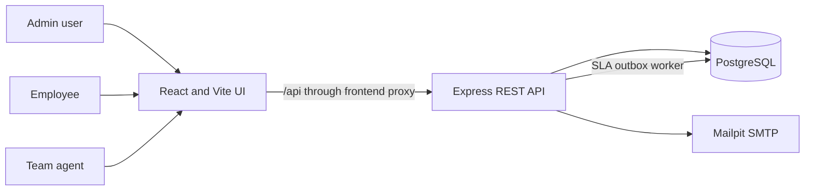

# Requirements, design and architecture

## Project summary

The Employee Service Request System (ESR) is an internal service desk for employee IT, HR and Facility requests. Employees submit and track their own requests; agents work requests for their assigned team; administrators oversee requests, accounts and reporting.

## Users and goals

| User | Goal |
|---|---|
| Employee | Submit a complete request, see its current status and SLA, and receive help without seeing another employee's requests. |
| Agent | Review requests for their team, assign work to themselves, and update request status. |
| Administrator | View all requests, assign them to active agents in the matching team, manage accounts, and review dashboard and audit information. |

## Functional requirements and implementation

| ID | Requirement | Implementation |
|---|---|---|
| FR-01 | Authenticate users and distinguish employee, agent and admin roles. | JWT login and role middleware in `backend/src/app.js`; role-specific interface in `frontend/src/App.jsx`. |
| FR-02 | Allow employees to create IT, HR or Facility requests with a title, description and priority. | Request form; API validation; relational request record. |
| FR-03 | Restrict request visibility to the employee's own requests, an agent's team, or all requests for an admin. | Role-based SQL scope used by paginated request, dashboard and SLA-alert endpoints. |
| FR-04 | Set deadlines using priority and show overdue work. | High = 4 hours, Medium = 24 hours, Low = 72 hours; dashboard and notification endpoints identify breaches. |
| FR-05 | Let agents take work and update status; let admins assign an active agent on the request's team. | Request PATCH endpoint validates role, team and eligible assignee. |
| FR-06 | Let administrators create, update and deactivate accounts. | Admin-only user endpoints and user-management interface. |
| FR-07 | Keep a record of request and account changes. | Audit entries are recorded in the same database transaction as the relevant change. |
| FR-08 | Provide dashboard summaries and paginated request queues. | Dashboard aggregates by status, team and priority; requests support page and pageSize. |
| FR-09 | Notify relevant people of SLA breaches and support password recovery. | Email outbox with retry handling; one-hour, single-use password reset tokens. |
| FR-10 | Protect login and account operations. | Password hashes, request validation, login/reset rate limits, JWT session revocation, and active-account checks. |

## Quality requirements

- **Security:** protect routes by role, scope data server-side, hash passwords and reset tokens, and do not expose whether an email exists during a password-reset request.
- **Reliability:** write audit records transactionally; queue SLA emails and retry temporary delivery failures.
- **Usability:** responsive layouts, clear request status and remaining-SLA indicators, and role-specific controls.
- **Maintainability:** separate React UI, Express API, PostgreSQL migrations and SLA logic; use environment configuration for deployment.
- **Reproducibility:** Docker Compose supplies PostgreSQL, API, frontend and local Mailpit email capture.

## Architecture

In Docker, Nginx serves the built frontend on port 3000 and proxies API calls to the backend on port 4000. PostgreSQL stores accounts, requests, audit entries, password reset tokens and email outbox jobs. Mailpit captures development email on port 8025.

## Data model

- `users`: identity, password hash, role, optional team, active flag and token version.
- `requests`: title, description, category/team, priority, status, requester, optional assignee, SLA deadline and timestamps.
- `audit_log`: actor, optional request, action, detail and timestamp.
- `password_reset_tokens`: hashed one-time token, owner, expiry and usage time.
- `email_outbox`: recipient, message, retry/lock state and send time; a unique key prevents duplicate breach messages.

Migrations are in `backend/migrations/` and are applied by `backend/src/migrate.js`.

## API surface

| Method | Endpoint | Access |
|---|---|---|
| POST | `/api/auth/login` | Public |
| POST | `/api/auth/forgot-password` | Public, rate-limited |
| POST | `/api/auth/reset-password` | Public, rate-limited |
| GET | `/api/requests?page=1&pageSize=20` | Authenticated, role-scoped |
| POST | `/api/requests` | Employee |
| PATCH | `/api/requests/:id` | Agent for own team; admin |
| GET | `/api/dashboard`, `/api/notifications` | Authenticated, role-scoped |
| GET, POST | `/api/users`; PATCH `/api/users/:id` | Admin |
| GET | `/api/agents` | Agent or admin |
| GET | `/api/audit` | Admin |

## Boundaries and future work

The supplied accounts and shared demo password are for local demonstration only. Production deployment must provide a strong `JWT_SECRET`, real SMTP credentials, HTTPS, backups, and an operational database. Dashboard caching and horizontal API scaling are future performance improvements, not current features.
